# proxmox-homelab

Proxmox VE 9 on an HP EliteDesk 800 G3 Mini – the base hypervisor for my IT admin homelab.

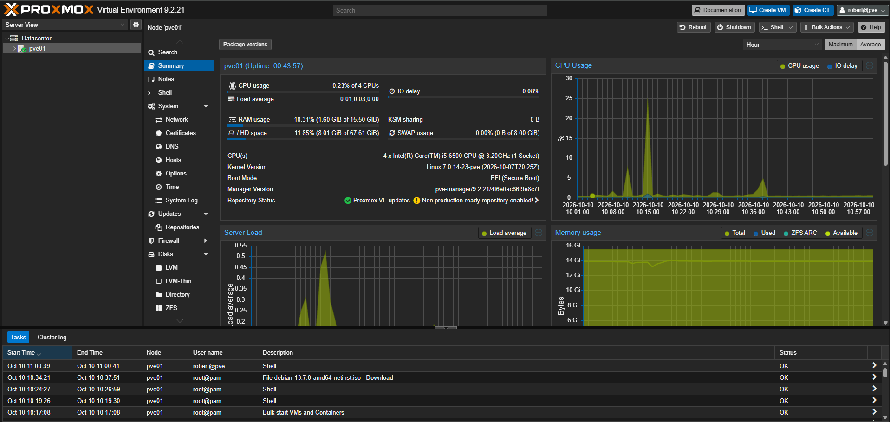

---

## Overview

This project documents how I turned a used office mini PC (shipped with preinstalled Windows) into a **Proxmox VE hypervisor**. It is the foundation for all upcoming homelab projects (Active Directory, DNS, file services, Linux servers, …).

**Goals**

- Bare-metal installation of Proxmox VE on the HP EliteDesk 800 G3 Mini
- Planned static network configuration outside the router's DHCP range
- Clean update path without a paid subscription
- Documented network bridge and storage layout
- Personal admin account with group-based permissions and 2FA instead of daily root usage

**Result:** A fully patched, single-node Proxmox VE 9.2 host at `https://192.168.2.10:8006`, managed from my ThinkPad via `robert@pve` with TOTP.

---

## Architecture / Setup

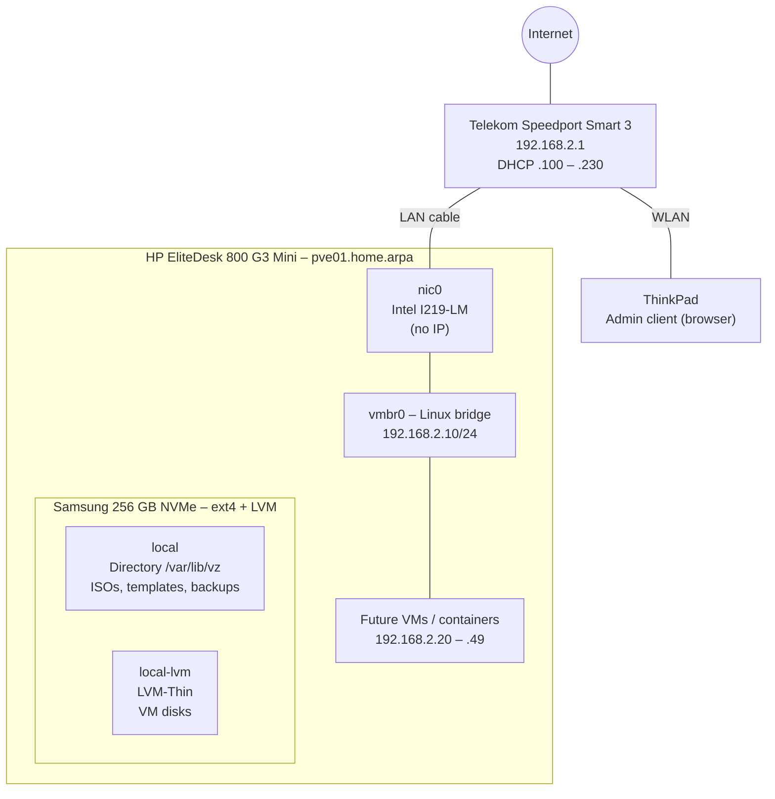

### Hardware

| Component | Details |
|-----------|---------|
| Host | HP EliteDesk 800 G3 Mini |
| CPU | Intel Core i5-6500 (4 cores, 3.2 GHz, VT-x / VT-d) |
| RAM | 16 GB |
| Storage | Samsung 256 GB NVMe SSD |
| Network | Intel I219-LM 1 GbE (`nic0`) |
| Admin client | Lenovo ThinkPad (Windows, web UI access) |

### IP Plan (192.168.2.0/24)

| Range / Address | Purpose |
|-----------------|---------|
| 192.168.2.1 | Router (Speedport Smart 3), gateway + DNS |
| **192.168.2.10** | **Proxmox host `pve01.home.arpa`** |
| 192.168.2.11 – .19 | Reserved: infrastructure |
| 192.168.2.20 – .49 | Reserved: homelab VMs |
| 192.168.2.100 – .230 | Router DHCP pool (untouched) |

`home.arpa` is the domain reserved for home networks (RFC 8375).

---

## Tech Stack

| Area | Technology |
|------|------------|
| Hypervisor | Proxmox VE 9.2 (Debian 13 "trixie"), kernel 7.0.14-23-pve |
| Virtualization | KVM / QEMU, LXC |
| Filesystem / storage | ext4, LVM-Thin |
| Networking | Linux bridge (`vmbr0`), static IPv4 |
| Security | UEFI Secure Boot, PVE realm user, role-based access control, TOTP 2FA |
| Package management | APT, `pve-no-subscription` repository (deb822 `.sources` format) |
| Tooling | Rufus 4.15 (DD mode), PowerShell (`Get-FileHash`), Git |

---

## Steps Taken

### 1. Preparation
1. **Network planning** – read the DHCP range from the Speedport (only visible in *Expertenmodus*) and chose `192.168.2.10` outside of it. Verified the address was free with `ping`.
2. **ISO download and verification** – downloaded the Proxmox VE 9.2 ISO (x86-64) and compared its SHA256 hash in PowerShell:
   ```powershell
   $expected = "4e88fe416df9b527624a175f24c9aa07c714d3332afb1ee3dbf3879573ef2c6c"
   $actual   = (Get-FileHash "$HOME\Downloads\proxmox-ve_9.2-1.iso" -Algorithm SHA256).Hash
   $actual -eq $expected   # True
   ```
3. **Bootable USB stick** – written with Rufus; the ISOHybrid image forced DD mode automatically.
4. **BIOS (HP Computer Setup, F10)**

   | Setting | Value | Reason |
   |---------|-------|--------|
   | VTx | Enabled | Required for KVM |
   | VTd | Enabled | PCI passthrough later |
   | Boot mode | UEFI only, Secure Boot on, MS UEFI CA key enabled | Proxmox boots via a Microsoft-signed shim |
   | After Power Loss | Power On | Server restarts after a power outage |
   | Startup Delay | 5 sec | Makes F9 / F10 reachable with Fast Boot enabled |

### 2. Installation
| Setting | Value |
|---------|-------|
| Target disk | `/dev/nvme0n1` (internal NVMe, Windows overwritten) |
| Filesystem | **ext4** with default partitioning (root / swap / LVM-Thin) |
| Locale | Germany, Europe/Berlin, keymap `de` |
| Network | `nic0` → `192.168.2.10/24`, gateway/DNS `192.168.2.1`, interface name pinned |
| Hostname | `pve01.home.arpa` |

**Filesystem decision**

| Option | Verdict | Reason |
|--------|---------|--------|
| ext4 + LVM-Thin | ✅ Chosen | Single SSD, low RAM overhead, Proxmox default, LVM-Thin still supports VM snapshots |
| ZFS (single disk) | ❌ Rejected | No redundancy or self-healing with one disk, ARC cache uses RAM needed for VMs, higher SSD wear |

### 3. Repositories & Updates
- Disabled the **pve-enterprise** and **Ceph enterprise** repositories (they require a subscription).
- Added the free **pve-no-subscription** repository → `apt-get update` returns `TASK OK`.
- Ran a full upgrade, later a second update round (21 packages incl. OpenSSL fixes and a new kernel) and rebooted **once** to activate kernel `7.0.14-23-pve`.

### 4. Network Bridge
Verified the bridge created by the installer and saved the config to [`configs/network-interfaces`](configs/network-interfaces):

```
auto vmbr0
iface vmbr0 inet static
        address 192.168.2.10/24
        gateway 192.168.2.1
        bridge-ports nic0
        bridge-stp off
        bridge-fd 0
```

- The host IP lives on the **bridge**, `nic0` is only its uplink port (no IP).
- STP off / forward delay 0 – a single uplink cannot create a loop.
- VLAN awareness off – the Speedport has no VLAN support.

### 5. Storage
| Storage | Type | Content | Purpose |
|---------|------|---------|---------|
| `local` | Directory (`/var/lib/vz`) | ISO images, container templates, backups, import | File-based content |
| `local-lvm` | LVM-Thin | VM disks, containers | Block storage with thin provisioning + snapshots |

Default layout kept on purpose. Tested by downloading `debian-13.7.0-amd64-netinst.iso` via **Download from URL** with SHA-256 verification (`checksum verified`, `TASK OK`).

### 6. Users, Permissions & 2FA
```
User           →  Group    →  Permission
robert@pve        admins      Path "/" · Role Administrator · Propagate
```
- `robert@pve` uses the **Proxmox VE authentication server** realm – the account exists only in Proxmox, not as a Linux/SSH user.
- Rights are assigned to the **group**, not the user (scales like AGDLP in Active Directory).
- **TOTP 2FA** plus recovery keys (stored in a password manager).
- `root@pam` is kept as a **break-glass account** only. Web UI 2FA does not affect the local console, so physical emergency access always remains.

---

## Challenges & Solutions

| # | Challenge | Cause | Solution |
|---|-----------|-------|----------|
| 1 | DHCP range not visible in the Speedport UI | Hidden in *Standardmodus* | Switched to *Expertenmodus* → Netzwerk → Heimnetzwerk (LAN) → DHCP |
| 2 | `Test-Connection` threw a cryptic `PingException` | Windows PowerShell 5.1 reports an unanswered ping as an exception | Verified with classic `ping` – "Destination host unreachable" from own client = IP free |
| 3 | Partition scheme / target system greyed out in Rufus | Proxmox ISO is ISOHybrid → Rufus forces DD mode | No action needed – the image carries its own UEFI-capable partition table |
| 4 | Booted into the preinstalled Windows setup instead of USB | Windows Boot Manager first in boot order, F9 pressed too late (Fast Boot, 0 sec delay) | Tapped F9 right after power-on; set startup delay to 5 sec |
| 5 | `apt-get update` failed (exit code 100) | Only enterprise repos enabled after install → HTTP 401 without subscription | Disabled enterprise repos, enabled `pve-no-subscription` |
| 6 | New kernel not active after 16 days uptime | Reboot after the kernel update was never done | Installed pending updates first, then one reboot → kernel 7.0.14-23 |
| 7 | Upgrade aborted after download (`^C`) | Ctrl+C cancelled apt before unpacking | `dpkg --configure -a`, then `apt full-upgrade` again – cached packages reused (0 B download) |
| 8 | Upgrade button opened no console / dead console window | Browser popup blocker, then an ended console session | Allowed popups for `:8006`, used the node shell (pve01 → Shell) |
| 9 | Git command pasted into the Proxmox shell | Wrong window focused | Discarded with Ctrl+C – always check the prompt before pasting (`PS C:\>` vs `root@pve01:~#`) |
| 10 | Git warning "LF will be replaced by CRLF" | Git for Windows default `core.autocrlf=true` | Added `.gitattributes` (`* text=auto eol=lf`) so Linux configs keep LF line endings |
| 11 | Browser certificate warning on port 8006 | Self-signed certificate | Accepted for the homelab (trusted certificate = future improvement) |

---

## Key Learnings

- **Plan the network first.** A static IP outside the DHCP pool and a reserved IP plan prevent conflicts before the first VM exists.
- **Verify downloads.** SHA256 checks on the ThinkPad and directly on the server (Download from URL) – same principle, two tools.
- **Know the update model.** Enterprise vs. no-subscription repositories, and that a **new kernel only becomes active after a reboot**. Collect updates first, then reboot once.
- **Read warnings instead of panicking.** Most upgrade warnings (Ceph, watchdog, ESP sync) were irrelevant for a single ext4 node.
- **Linux bridges = virtual switches.** The host IP sits on `vmbr0`, the physical NIC is only the uplink. Pinned interface names protect against renaming after kernel updates.
- **Choose technology by requirement, not hype.** ZFS is great – but not on a single 256 GB SSD with 16 GB RAM.
- **Least privilege & auditability.** Personal admin account, group-based roles, 2FA, root as break-glass. The task log now shows *who* did what (`robert@pve` vs. `root@pam`).
- **Never publish secrets.** No passwords, QR codes or recovery keys in screenshots; MAC addresses and e-mail addresses blurred.

---

## Screenshots

| # | Step | Screenshot |
|---|------|------------|
| 01 | Router DHCP range (192.168.2.100 – .230) | 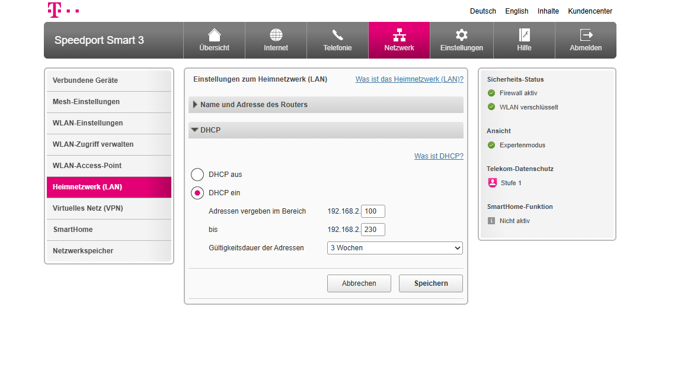 |
| 02 | ISO SHA256 verification in PowerShell | 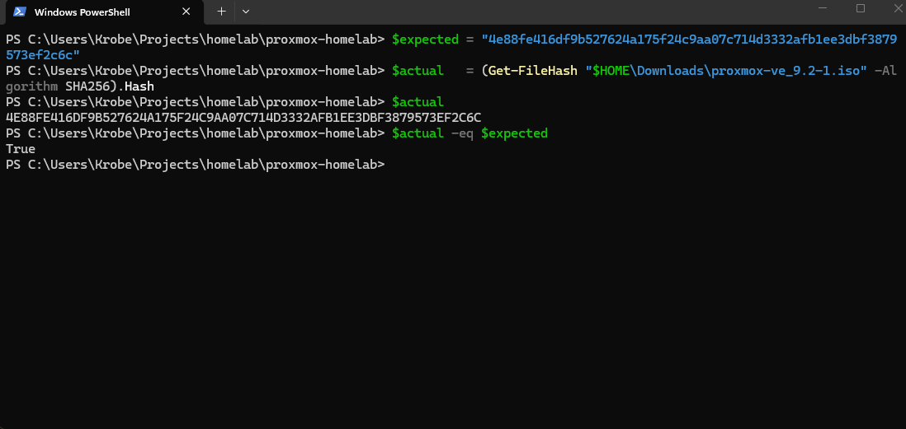 |
| 03 | Rufus forces DD mode (ISOHybrid) | 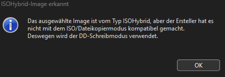 |
| 04 | BIOS – VTx / VTd enabled | 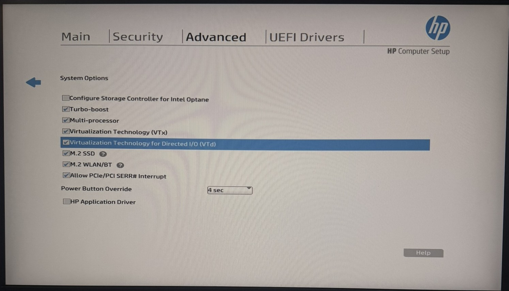 |
| 05 | Proxmox installer boot menu | 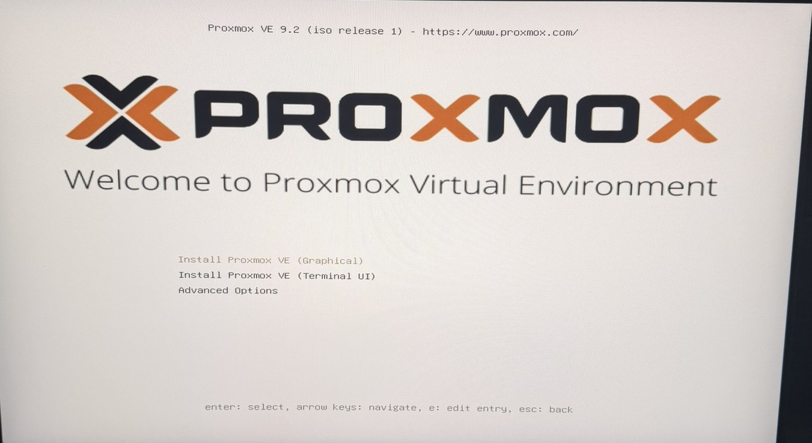 |
| 06 | Installer – target disk | 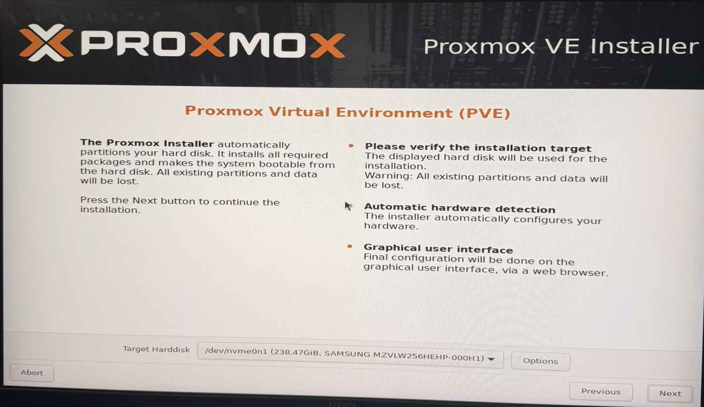 |
| 07 | Installer – ext4 filesystem | 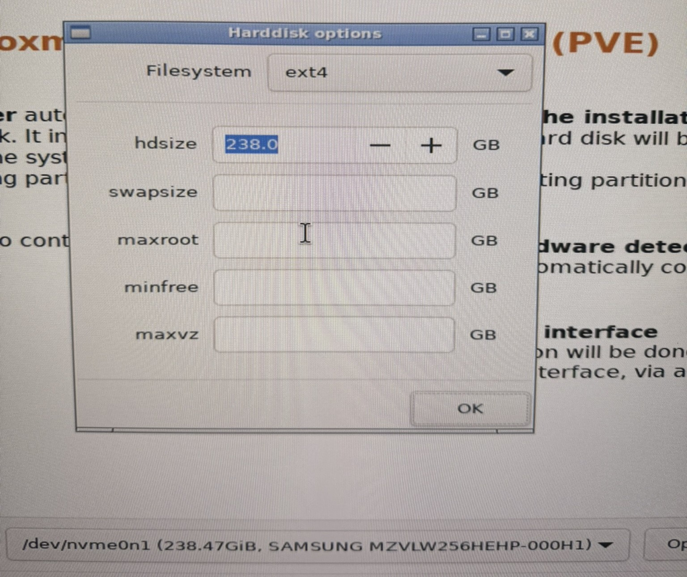 |
| 08 | Installer – management network | 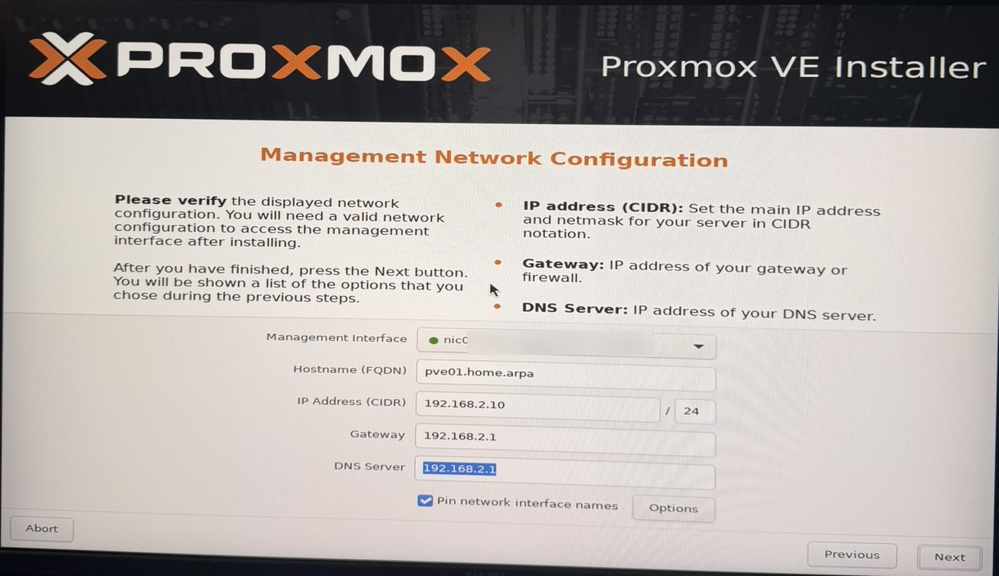 |
| 09 | Installer – summary | 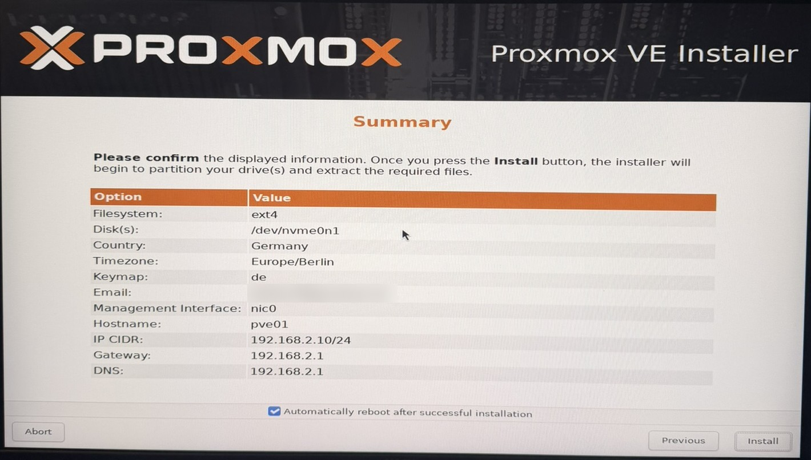 |
| 10 | First boot console | 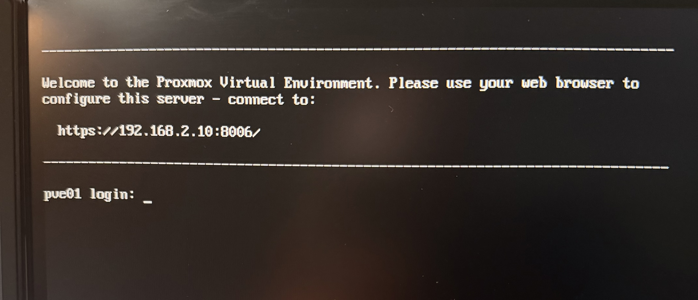 |
| 11 | First login – web UI dashboard | 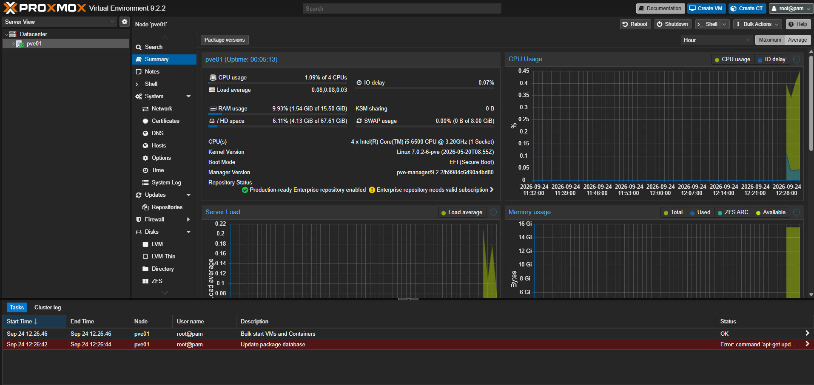 |
| 12 | `apt-get update` error (enterprise repo) | 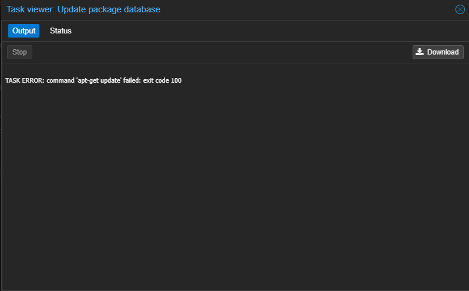 |
| 13 | Repositories fixed (no-subscription) | 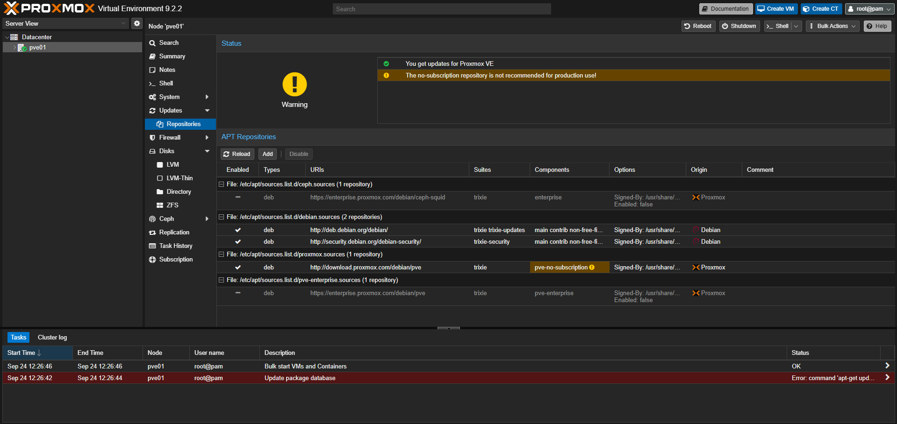 |
| 14 | Package refresh – TASK OK | 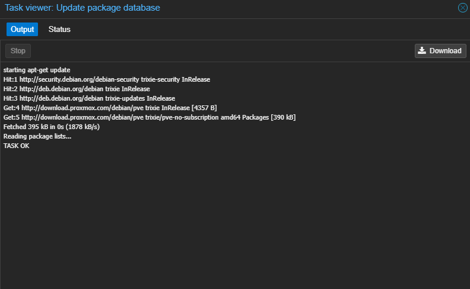 |
| 15 | Pending updates after 16 days | 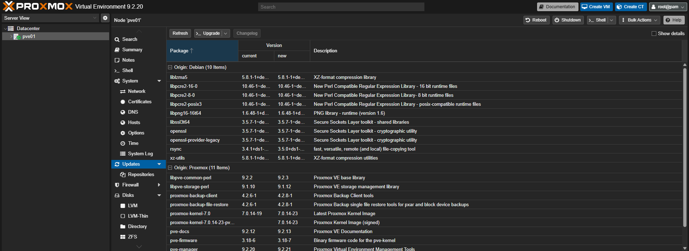 |
| 16 | New kernel active after reboot | 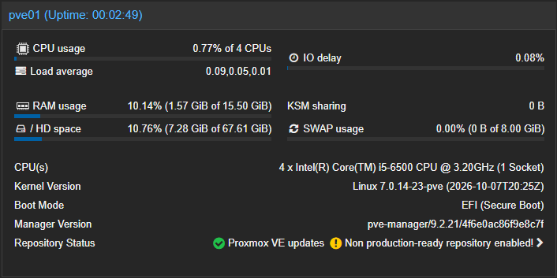 |
| 17 | Network – `nic0` + `vmbr0` | 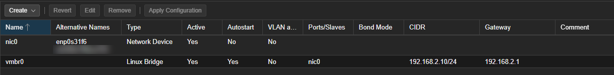 |
| 18 | Storage overview | 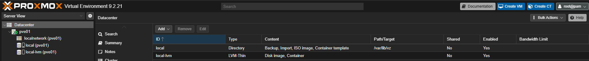 |
| 19 | ISO download with SHA-256 | 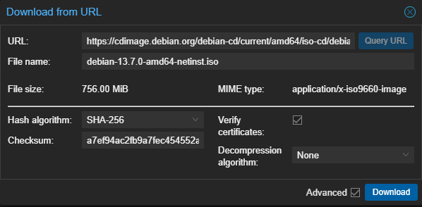 |
| 20 | ISO download – checksum verified | 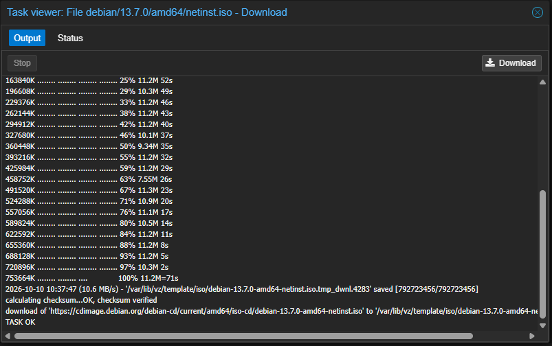 |
| 21 | Group permission `/` · `@admins` · Administrator | 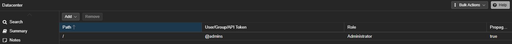 |
| 22 | 2FA – TOTP + recovery keys | 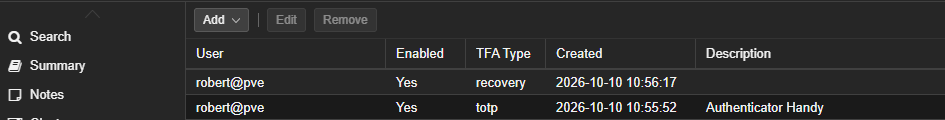 |
| 23 | Final state – logged in as `robert@pve` |  |

---

## Future Improvements

- TOTP 2FA for `root@pam` as well
- Trusted TLS certificate for the web UI (e.g. ACME / internal CA)
- Scheduled backups (vzdump), later Proxmox Backup Server
- SMTP relay so alert mails actually arrive
- VLAN-aware bridge once a managed switch is available
- First VMs: Windows Server (AD DS, DNS, DHCP), Debian server, self-hosted cloud

## Repository Structure

```
proxmox-homelab/
├── README.md
├── .gitattributes          # LF line endings for Linux configs
├── .gitignore              # no secrets, no ISOs
├── configs/
│   └── network-interfaces  # copy of /etc/network/interfaces
├── docs/
│   └── notes.md            # raw working notes
└── screenshots/            # 01–23
```

## License

[MIT](LICENSE)
